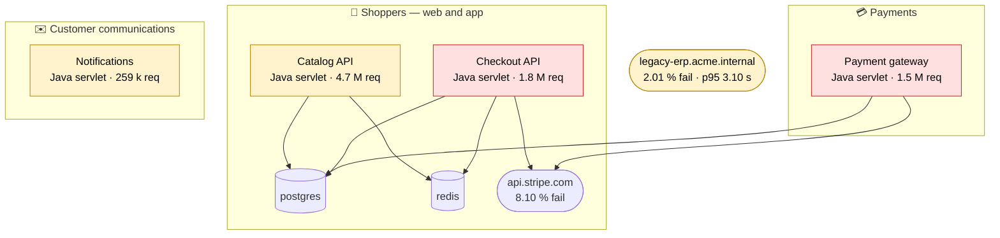
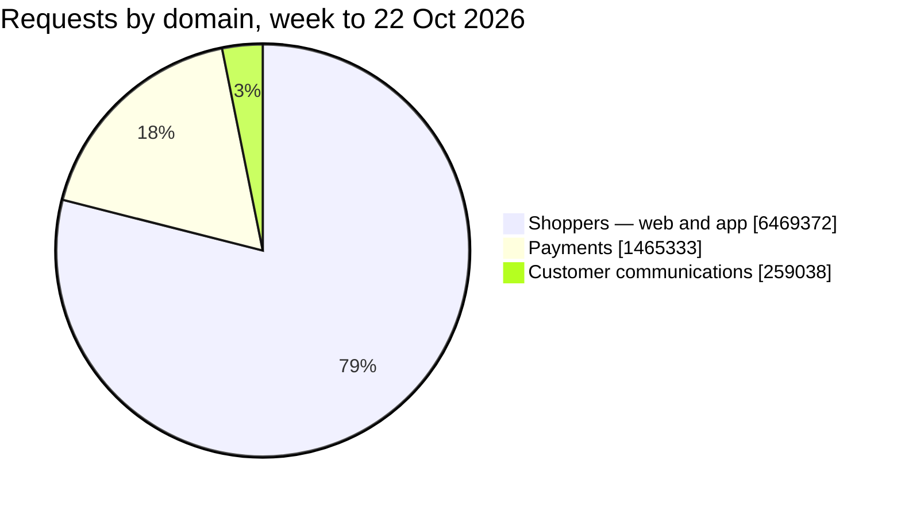
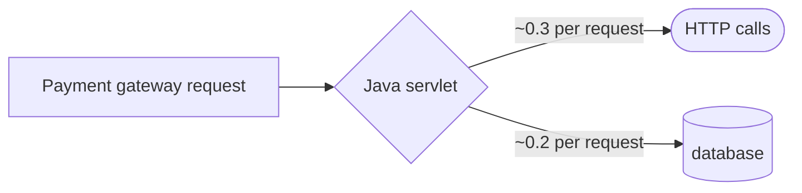

# Acme Retail — Observability Review, October 2026

**What Acme Retail's Shoppers — web and app, Payments and Customer communications systems did in the week to 22 Oct 2026, what it means for shoppers and finance, and what to do next.**

Prepared for Acme Retail Digital · Vsceptre Observability-as-a-Service · 22 Oct 2026

> 📖 **How to read this notebook.** Eight findings, each with the evidence, the impact and the actions. Graphs marked *➕ live graph* can be added in a minute with `/timeseries` so the page stays current. Numbers come from Datadog APM's Endpoints list (the week to 22 Oct 2026), the APM Services list and a trace sample of 9 minutes (22 Oct 02:00–02:09 UTC). Use **⋮ → Download as PDF** to circulate.

---

## 📌 Executive summary

| # | Finding | Who feels it | Severity | Action |
|---|---|---|---|---|
| 1 | **One in twelve card authorisations fails** on `payment-gateway` (31,398 of 348,872 in the week to 22 Oct 2026); refunds fail 45.0 %; clients request about 2.87 new tokens per business call | Shoppers and finance | 🔴 | Root-cause the `POST /pay/authorise` failures; alert on regressions; cache tokens until expiry |
| 2 | **One in fifty checkouts fails** on `checkout-api` (8,304 of 395,426 in the week to 22 Oct 2026) | Shoppers | 🔴 | Root-cause the `POST /api/checkout` failures; alert on regressions |
| 3 | **Payment gateway is slow on two of its features** — 26 % of its traffic is on operations with p95 above 2.00 s; the slowest frequent one is `POST /pay/authorise` at 2.66 s | Shoppers and finance | 🟠 | Profile the request path; set a latency target |
| 4 | **One slow operation in Shoppers — web and app** — `GET /api/search` takes 4.39 s at p95 on 880,758 calls in the week to 22 Oct 2026 | Shoppers | 🟠 | Tune the slow queries and downstream calls |
| 5 | **1.20 % of `send_email` calls fail** on `notify-worker` (3,108 of 259,038 in the week to 22 Oct 2026); it has **no monitors** | Shoppers | 🟠 | Root-cause the `send_email` failures; alert on regressions |
| 6 | **Observability foundations are thin** — Monitors on 2 of 4 services; no SLOs; scanner traffic in APM | Everyone who operates the estate | 🟠 | Monitors on every service, SLOs and ingestion hygiene |
| 7 | **Vulnerability scans reach `checkout-api`** (4 probe endpoints, none answered) | Security | 🟠 | Block scanner traffic at the edge |
| 8 | **One dependency is slow** — `legacy-erp.acme.internal` p95 3.10 s | Users and staff, depending on the caller | 🟠 | Agree a timeout and a latency target |

**Delivered alongside this review:** the *Acme [Leadership] — Shop Health at a Glance* dashboard and a pack of 6 monitors

---

## 🗺️ What Datadog sees today

Four traced services, 15 endpoints and 8.2 million requests in the week to 22 Oct 2026, across three domains. The map shows only connections the data shows (parent/child spans).

| Domain | Services | Requests (week to 22 Oct 2026) | Failed (business) | p95 |
|---|---|---|---|---|
| 🛒 Shoppers — web and app | `catalog-api`, `checkout-api` | 6,469,372 (6,066,031 business) | 0.27 % (0.25 % counting health checks and other noise) | **1.67 s–4.39 s** |
| 💳 Payments | `payment-gateway` | 1,465,333 | 3.05 % | **2.66 s** |
| ✉️ Customer communications | `notify-worker` | 259,038 | 1.20 % | 746 ms |

> 🎨 **A rule used throughout:** a request is *failed* when it returns a 5xx or records an application error; 4xx responses are not failures. Volumes count every request (APM trace metrics), not a sample.

---

## 🔴 Finding 1 — One in twelve card authorisations fails on Payment gateway; refunds fail 45.0 %

`payment-gateway` (part of Payments: card authorisation and refunds through the payment provider) handled 1.5 million business requests in the week to 22 Oct 2026 and failed 44,688 of 1,465,333 (3.05 %). They concentrate on two operations:

| Operation | Calls | Failed | Failure rate | p95 |
|---|---|---|---|---|
| `POST /pay/authorise` — card authorisations | 348,872 | **31,398** | **9.00 %** | 2.66 s |
| `POST /pay/refund` — refunds | 29,533 | **13,290** | **45.0 %** | 2.49 s |

- **`POST /pay/authorise` fails 31,398 of 348,872 (9.00 %)** in the week to 22 Oct 2026 — about 4,485 a day. Each failure is a user or an operator who has to retry, or work that is not done.
- **`POST /pay/refund` fails 13,290 of 29,533 (45.0 %)** — fewer calls, but the highest failure rate on the service: one in two calls fails.
- The agreed target for card authorisations is 99.5 % success; in the week to 22 Oct 2026 it achieved 91.0 %.
- 1,086,928 calls to `POST /oauth/token` for 378,405 calls to `payment-gateway`'s other business operations in the week to 22 Oct 2026 is **2.87 per call**. Tokens are normally cached until they expire; requesting them per call multiplies the load on the token endpoint, and each token request takes up to 89 ms (p95) before the business call can start.

**Actions**
1. Pull one day of `POST /pay/authorise` failures from the application log and classify them (validation, data, timeout, dependency).
2. Alert when `POST /pay/authorise` fails more than 380 times in an hour (about 2.0× the hourly average in the week to 22 Oct 2026, which is 187), and lower the threshold as the fix lands.
3. Track card authorisations against the agreed 99.5 % success target as a Datadog SLO, so the burn rate pages before the target is missed.
4. Cache the token in each client of `payment-gateway` until shortly before it expires — that removes at least 708,523 calls in the week to 22 Oct 2026 (the excess over one token per business call) and up to nearly all 1,086,928.

> ➕ **live graph** — `/timeseries` · `sum:trace.servlet.request.hits{service:payment-gateway,resource_name:post_/pay/authorise}.as_count()` (requests); `/timeseries` · `sum:trace.servlet.request.errors{service:payment-gateway,resource_name:post_/pay/authorise}.as_count()` (failures, as red bars)

---

## 🔴 Finding 2 — One in fifty checkouts fails on Checkout API

`checkout-api` (part of Shoppers — web and app: the storefront's catalogue, cart and checkout) handled 1.6 million business requests in the week to 22 Oct 2026 and failed 10,659 of 1,572,828 (0.68 %). The failures concentrate on one operation:

| Operation | Calls | Failed | Failure rate | p95 |
|---|---|---|---|---|
| `POST /api/checkout` — checkouts | 395,426 | 8,304 | 2.10 % | 1.67 s |

- **`POST /api/checkout` fails 8,304 of 395,426 (2.10 %)** in the week to 22 Oct 2026 — about 1,186 a day. Each failure is a user or an operator who has to retry, or work that is not done.
- The agreed target for checkouts is 99.5 % success; in the week to 22 Oct 2026 it achieved 97.9 %.

**Actions**
1. Pull one day of `POST /api/checkout` failures from the application log and classify them (validation, data, timeout, dependency).
2. Alert when `POST /api/checkout` fails more than 99 times in an hour (about 2.0× the hourly average in the week to 22 Oct 2026, which is 49), and lower the threshold as the fix lands.
3. Track checkouts against the agreed 99.5 % success target as a Datadog SLO, so the burn rate pages before the target is missed.

> ➕ **live graph** — `/timeseries` · `sum:trace.servlet.request.hits{service:checkout-api,resource_name:post_/api/checkout}.as_count()` (requests); `/timeseries` · `sum:trace.servlet.request.errors{service:checkout-api,resource_name:post_/api/checkout}.as_count()` (failures, as red bars)

---

## 🟠 Finding 3 — Payment gateway is slow on two of its features

`payment-gateway` (part of Payments: card authorisation and refunds through the payment provider) handled 1.5 million business requests in the week to 22 Oct 2026 with a 3.05 % failure rate overall — but **26 % of that traffic sits on operations whose p95 is above 2.00 s**:

| Feature | Calls (week to 22 Oct 2026) | p95 |
|---|---|---|
| `POST /pay/authorise` — card authorisations | 348,872 | 2.66 s |
| `POST /pay/refund` — refunds | 29,533 | 2.49 s |

*What the traces show inside a request (in the 9-minute sample; ratios are sample ratios):*

**Actions**
1. Turn on the Datadog continuous profiler for `payment-gateway` for a day — it shows wall time by function, including time the traces do not cover.
2. Set a latency target for the slow operations of `payment-gateway` (for example p95 under 2.00 s) and track it as an SLO.

> ➕ **live graph** — `/timeseries` · `p95:trace.servlet.request{service:payment-gateway}` (add a marker at the threshold); `/toplist` · `p95:trace.servlet.request{service:payment-gateway} by {resource_name}` (slowest features)

---

## 🟠 Finding 4 — One slow operation in Shoppers — web and app: `GET /api/search` (product searches) takes 4.39 s at p95

Most of what `catalog-api` serves is quick, but one frequent operation is slow in the week to 22 Oct 2026:

| Operation | Calls | p95 |
|---|---|---|
| `GET /api/search` — product searches | 880,758 | 4.39 s |

- `GET /api/search` is the costliest: 880,758 calls at 4.39 s p95 — each call keeps a user waiting.
- The agreed p95 target for product searches is 2.00 s; it runs at 4.39 s on `catalog-api`.

**Actions**
1. Profile `GET /api/search` on `catalog-api` (query plan, downstream calls) to bring it under its agreed 2.00 s p95.

> ➕ **live graph** — `/timeseries` · `p95:trace.servlet.request{service:catalog-api}` (add a marker at the threshold); `/toplist` · `p95:trace.servlet.request{service:catalog-api} by {resource_name}` (slowest features)

---

## 🟠 Finding 5 — 1.20 % of `send_email` calls fail on Notifications, and nothing is watching it

`notify-worker` (part of Customer communications: order and shipping e-mails) handled 259,038 business requests in the week to 22 Oct 2026 and failed 3,108 of 259,038 (1.20 %). All of them are on its one operation:

| Operation | Calls | Failed | Failure rate | p95 |
|---|---|---|---|---|
| `send_email` | 259,038 | 3,108 | 1.20 % | 746 ms |

- **`send_email` fails 3,108 of 259,038 (1.20 %)** in the week to 22 Oct 2026 — about 444 a day. Each failure is a user or an operator who has to retry, or work that is not done.
- **No monitor watches `notify-worker`**, so none of these failures pages anyone.

**Actions**
1. Add a failure-rate monitor on `notify-worker` — it has no monitor today — and alert when `send_email` fails more than 37 times in an hour (about 2.0× the hourly average in the week to 22 Oct 2026, which is 18), and lower the threshold as the fix lands.
2. Pull one day of `send_email` failures from the application log and classify them (validation, data, timeout, dependency).

> ➕ **live graph** — `/timeseries` · `sum:trace.servlet.request.hits{service:notify-worker,resource_name:send_email}.as_count()` (requests); `/timeseries` · `sum:trace.servlet.request.errors{service:notify-worker,resource_name:send_email}.as_count()` (failures, as red bars)

---

## 🟠 Finding 6 — Observability foundations are thin

Three gaps in how the estate is instrumented and tagged. Not one of them hurts a user today; each makes the next incident longer.

| Gap | Evidence | Why it matters |
|---|---|---|
| Monitors on 2 of 4 services | none on `catalog-api` and `notify-worker` | a service can fail silently |
| No SLOs | the SLOs column is empty for every service | no shared definition of "good enough" |
| Scanner traffic in APM | 4 of 7 endpoints on `checkout-api` are probes | noise in the endpoint catalogue and error rates |

**Actions**
1. Add failure-rate and latency monitors to `catalog-api`.
2. Agree SLOs for the customer-facing services and review them monthly.
3. Ingestion hygiene: exclude scanner traffic.

---

## 🟠 Finding 7 — Vulnerability scans reach Checkout API

4 of `checkout-api`'s 7 endpoints in Datadog are scanner probes (141 requests in the week to 22 Oct 2026): `GET /.env`, `PROPFIND /`, `GET /wp-login.php` and `GET /manager/html`.

| Probe | Requests | Failure rate | Result |
|---|---|---|---|
| `GET /.env` | 57 | 100 % | failed (no status code in the export) |
| `PROPFIND /` | 35 | 100 % | failed (no status code in the export) |
| `GET /wp-login.php` | 30 | 100 % | failed (no status code in the export) |
| `GET /manager/html` | 19 | 100 % | failed (no status code in the export) |

- No sensitive path answered, so this is hygiene: noise in the endpoint catalogue and in the error rate.

**Actions**
1. Drop scanner traffic at the edge (WAF or IP allow-list) and exclude it from APM error monitors.

---

## 🟠 Finding 8 — One dependency is slow

Datadog infers these services from outbound calls. In the Services-list export, about 6 days:

| Dependency | Calls | Failed | p95 | Callers |
|---|---|---|---|---|
| `legacy-erp.acme.internal` | 1,440 | 2.01 % | **3.10 s** | none in the sample |
| `api.stripe.com` | 520,000 | 8.10 % (42,120) | 520 ms | `checkout-api`, `payment-gateway` |

- Slow but answering: `legacy-erp.acme.internal` p95 3.10 s.
- Also failing, below the 15 % dependency bar: `api.stripe.com` 8.10 % (42,120 of 520,000 calls; callers `checkout-api` and `payment-gateway`).
- Callers come from the span sample (parent/child span join); the dependency's page in APM › Software Catalog shows the full picture.

**Actions**
1. Agree a timeout and a p95 target for `legacy-erp.acme.internal` with its owner.

> 🔎 open APM › Software Catalog › `legacy-erp.acme.internal` › Dependencies for the callers and the live error rate (peer-tag metrics are not exposed on trace.* metrics)

---

## 📝 Also noted

- 🟠 **Servers call the public internet** — `www.youtube.com` — *Allow-list egress*

---

## ✅ Recommendations, in order

| When | What | Why |
|---|---|---|
| **Now** | Pull one day of `POST /pay/authorise` failures from the application log and classify them (validation, data, timeout, dependency) | Finding 1 — One in twelve card authorisations fails on Payment gateway; refunds… |
| **Now** | Alert when `POST /pay/authorise` fails more than 380 times in an hour (about 2.0× the hourly average in the week to 22 Oct 2026, which is 187), and lower the threshold as the fix lands | Finding 1 — One in twelve card authorisations fails on Payment gateway; refunds… |
| **Now** | Pull one day of `POST /api/checkout` failures from the application log and classify them (validation, data, timeout, dependency) | Finding 2 — One in fifty checkouts fails on Checkout API |
| **Now** | Alert when `POST /api/checkout` fails more than 99 times in an hour (about 2.0× the hourly average in the week to 22 Oct 2026, which is 49), and lower the threshold as the fix lands | Finding 2 — One in fifty checkouts fails on Checkout API |
| **Now** | Add a failure-rate monitor on `notify-worker` — it has no monitor today — and alert when `send_email` fails more than 37 times in an hour (about 2.0× the hourly average in the week to 22 Oct 2026, which is 18), and lower the threshold as the fix lands | Finding 5 — 1.20 % of `send_email` calls fail on Notifications, and nothing is… |
| **Now** | Pull one day of `send_email` failures from the application log and classify them (validation, data, timeout, dependency) | Finding 5 — 1.20 % of `send_email` calls fail on Notifications, and nothing is… |
| **Now** | Add failure-rate and latency monitors to `catalog-api` | Finding 6 — Observability foundations are thin |
| **Next** | Track card authorisations against the agreed 99.5 % success target as a Datadog SLO, so the burn rate pages before the target is missed | Finding 1 — One in twelve card authorisations fails on Payment gateway; refunds… |
| **Next** | Cache the token in each client of `payment-gateway` until shortly before it expires — that removes at least 708,523 calls in the week to 22 Oct 2026 (the excess over one token per business call) and up to nearly all 1,086,928 | Finding 1 — One in twelve card authorisations fails on Payment gateway; refunds… |
| **Next** | Track checkouts against the agreed 99.5 % success target as a Datadog SLO, so the burn rate pages before the target is missed | Finding 2 — One in fifty checkouts fails on Checkout API |
| **Next** | Turn on the Datadog continuous profiler for `payment-gateway` for a day — it shows wall time by function, including time the traces do not cover | Finding 3 — Payment gateway is slow on two of its features |
| **Next** | Profile `GET /api/search` on `catalog-api` (query plan, downstream calls) to bring it under its agreed 2.00 s p95 | Finding 4 — One slow operation in Shoppers — web and app: `GET /api/search`… |
| **Next** | Ingestion hygiene: exclude scanner traffic | Finding 6 — Observability foundations are thin |
| **Next** | Drop scanner traffic at the edge (WAF or IP allow-list) and exclude it from APM error monitors | Finding 7 — Vulnerability scans reach Checkout API |
| **Next** | Agree a timeout and a p95 target for `legacy-erp.acme.internal` with its owner | Finding 8 — One dependency is slow |
| **Later** | Set a latency target for the slow operations of `payment-gateway` (for example p95 under 2.00 s) and track it as an SLO | Finding 3 — Payment gateway is slow on two of its features |
| **Later** | Agree SLOs for the customer-facing services and review them monthly | Finding 6 — Observability foundations are thin |

---

## 📎 Appendix

**Data analysed.**
- APM Endpoints list `endpoints.csv`: 15 endpoints, 7 days to 22 Oct 2026 — 7 days as stated for this review, consistent with the health-check cadence: `GET /actuator/health` on `catalog-api` 201,600 requests = one every 3.000 s; `GET /actuator/health` on `checkout-api` 201,600 requests = one every 3.000 s (the cadence also fits 14 and 28 days, so it cannot confirm the range).
- Inferred services `inferred.tsv`: 5 hosts and entities the traced services call; volumes are in the Services-list export, about 6 days.
- APM Services list `services.tsv`: 4 services (p95, monitors, SLOs, env tags; its volumes cover about 6 days, so they are not mixed with the Endpoints list).
- Trace sample `spans-2026-10-22.csv`: 19,450 spans, 2026-10-22 02:00:00–02:09:02 UTC (9 minutes).

**Definitions.** *Failed* = a request that returns a 5xx or records an application error; 4xx responses are not failures. *p95* = 95 % of requests finish within this time. Service p95 comes from the APM Services list. Request volumes are APM trace metrics, which count every request regardless of trace sampling. Entry requests in the span sample were identified by the rule *a root span, or a span whose parent belongs to another service (integration libraries and host names excluded)*.

**Noise excluded from business totals** (every exclusion, with the rule that made it):

| Class | Rule | Source | Endpoints | Requests removed | Failures removed |
|---|---|---|---|---|---|
| health | built-in health pattern | builtin | 2 | 403,200 | 0 |
| scanner | built-in scanner pattern | builtin | 4 | 141 | 141 |

**All traced services** (requests in the week to 22 Oct 2026; failure % on business operations; p95 from the Services list):

| Service | Requests | Failure % (business) | p95 | Monitors | Stack / operation |
|---|---|---|---|---|---|
| `catalog-api` (Catalog API) | 4,694,803 | 0.13 % | 4.39 s | 0 | Java servlet |
| `checkout-api` (Checkout API) | 1,774,569 | 0.68 % | 1.67 s | 2 | Java servlet |
| `payment-gateway` (Payment gateway) | 1,465,333 | 3.05 % | 2.66 s | 1 | Java servlet |
| `notify-worker` (Notifications) | 259,038 | 1.20 % | 746 ms | 0 | Java servlet |

**Not covered this month.** *regressions since last month* was not checked (needs last month's review: no earlier month was compared in this build).

**Caveats.**
- times are shown in UTC (the timezone 'Europe/London' could not be applied on the machine that built this review)
- the Services list volumes cover about 6 days against 7 days for the Endpoints list (median ratio 0.87); rates and p95 are comparable, volumes are not

**Method.** Every figure above was computed from the exports by the review generator (ddreview 1.0.0) and recorded in `facts.json`; keep that file to compare next month. Mermaid diagrams are drawn from the same tables. The generator writes a first draft in one command; read every finding before sharing.
