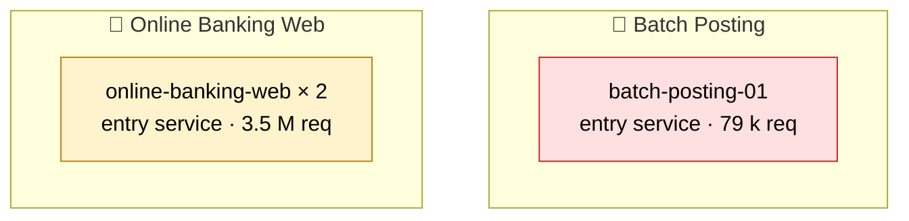
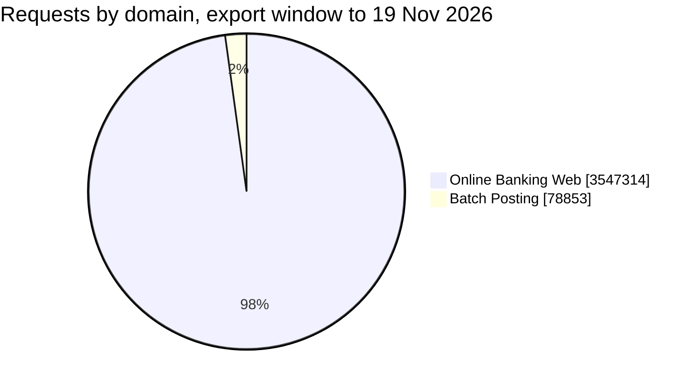

# northbank — Observability Review, November 2026

**What northbank's Online Banking Web and Batch Posting systems did in the export window to 19 Nov 2026, what it means for users, and what to do next.**

19 Nov 2026

> 📖 **How to read this notebook.** Seven findings, each with the evidence, the impact and the actions. Graphs marked *➕ live graph* can be added in a minute with `/timeseries` so the page stays current. Numbers come from Datadog APM's Endpoints list (the export window to 19 Nov 2026) and a trace sample of 12 minutes (19 Nov 09:30–09:42 UTC). Use **⋮ → Download as PDF** to circulate.

---

## 📌 Executive summary

| # | Finding | Who feels it | Severity | Action |
|---|---|---|---|---|
| 1 | **One in three `POST Batch/PostLedger` calls fails** on `batch-posting-01` (12,173 of 39,269 in the export window to 19 Nov 2026); `POST Batch/Reconcile` fails 30.0 %; it has **no monitors** | Users | 🔴 | Root-cause the `POST Batch/PostLedger` failures; alert on regressions |
| 2 | **`online-banking-web` has a very slow feature** — `GET Statements/Download` takes 31 s at p95 on 123,370 calls in the export window to 19 Nov 2026 | Users | 🟠 | Profile the request path; set a latency target |
| 3 | **Online Banking Web: node `online-banking-web-02` takes 47 % less traffic than its peer** | Users | 🟠 | Check the load-balancer pool and weights |
| 4 | **One in fifty `POST Payments/Transfer` calls fails** on `online-banking-web` (5,167 of 246,051 in the export window to 19 Nov 2026); also on `online-banking-web-02` | Users | 🟠 | Root-cause the `POST Payments/Transfer` failures; alert on regressions |
| 5 | **Two slow operations in Batch Posting** — the costliest is `POST Batch/PostLedger`, 9.48 s at p95 on 39,269 calls in the export window to 19 Nov 2026 | Users | 🟠 | Tune the slow queries and downstream calls |
| 6 | **Observability foundations are thin** — Monitors on 2 of 3 services; scanner traffic in APM | Everyone who operates the estate | 🟠 | Monitors on every service and ingestion hygiene |
| 7 | **Vulnerability scans reach `online-banking-web`** (3 probe endpoints, none answered) | Security | 🟠 | Block scanner traffic at the edge |

---

## 🗺️ What Datadog sees today

Three traced services, 12 endpoints and 3.6 million requests in the export window to 19 Nov 2026, across two domains. The exports do not say which service called which, so the map shows the services only.

| Domain | Services | Requests (export window to 19 Nov 2026) | Failed (business) | p95 (worst busy endpoint where no service p95 exists) |
|---|---|---|---|---|
| 🧩 Online Banking Web | `online-banking-web`, `online-banking-web-02` | 3,547,314 (3,305,342 business) | 0.41 % (0.38 % counting health checks and other noise) | **1.75 s–3.32 s** |
| 🧩 Batch Posting | `batch-posting-01` | 78,853 | 30.5 % | **9.48 s** |

> 🎨 **A rule used throughout:** a request is *failed* when it returns a 5xx or records an application error; 4xx responses are not failures. Volumes count every request (APM trace metrics), not a sample.

---

## 🔴 Finding 1 — One in three `POST Batch/PostLedger` calls fails on `batch-posting-01`; `POST Batch/Reconcile` fails 30.0 %, and nothing is watching it

`batch-posting-01` handled 78,853 business requests in the export window to 19 Nov 2026 and failed 24,048 of 78,853 (30.5 %). They concentrate on two operations:

| Operation | Calls | Failed | Failure rate | p95 |
|---|---|---|---|---|
| `POST Batch/PostLedger` | 39,269 | **12,173** | **31.0 %** | 9.48 s |
| `POST Batch/Reconcile` | 39,584 | **11,875** | **30.0 %** | 7.76 s |

- **`POST Batch/PostLedger` fails 12,173 of 39,269 (31.0 %)** in the export window to 19 Nov 2026. Each failure is a user or an operator who has to retry, or work that is not done.
- **No monitor watches `batch-posting-01`**, so none of these failures pages anyone.

**Actions**
1. Add a failure-rate monitor on `batch-posting-01` — it has no monitor today — and alert on the `trace.*.errors` metric for `POST Batch/PostLedger` at about twice its hourly average over the last 7 days (read that average in Datadog's Metrics Explorer; the export range is not proved, so no number is quoted here).
2. Pull one day of `POST Batch/PostLedger` failures from the application log and classify them (validation, data, timeout, dependency).
3. Agree a success-rate SLO for `POST Batch/PostLedger` calls (for example 99.5 % over 28 days) once the baseline is understood.

> ➕ **live graph** — `/timeseries` · `sum:trace.OPERATION.hits{service:batch-posting-01,resource_name:post_batch/postledger}.as_count()` (requests); `/timeseries` · `sum:trace.OPERATION.errors{service:batch-posting-01,resource_name:post_batch/postledger}.as_count()` (failures, as red bars; replace OPERATION with the span operation name: Metrics Explorer → type trace. → filter service:batch-posting-01)

---

## 🟠 Finding 2 — `online-banking-web` has a very slow feature: `GET Statements/Download` takes 31 s at p95

`online-banking-web` answers most of its 2.2 million business requests in the export window to 19 Nov 2026 quickly with a 0.39 % failure rate overall, but **`GET Statements/Download` takes 31 s at p95 on 123,370 calls** (6 % of the traffic):

| Feature | Calls (export window to 19 Nov 2026) | p95 |
|---|---|---|
| `POST Payments/Transfer` | 246,051 | 3.25 s |
| `GET Statements/Download` | 123,370 | **31 s** |

**Actions**
1. Turn on the Datadog continuous profiler for `online-banking-web` for a day — it shows wall time by function, including time the traces do not cover.
2. Set a latency target for the slow operations of `online-banking-web` (for example p95 under 2.00 s) and track it as an SLO.

> ➕ **live graph** — `/timeseries` · `p95:trace.OPERATION{service:online-banking-web}` (add a marker at the threshold; replace OPERATION with the span operation name: Metrics Explorer → type trace. → filter service:online-banking-web); `/toplist` · `p95:trace.OPERATION{service:online-banking-web} by {resource_name}` (slowest features)

---

## 🟠 Finding 3 — Online Banking Web: node `online-banking-web-02` takes 47 % less traffic than its peer

`online-banking-web-02` handled 1,139,957 business requests against 2,165,385 on the other node in the export window to 19 Nov 2026.

| Node | Business requests | Failure rate | p95 |
|---|---|---|---|
| `online-banking-web` | 2,165,385 | 0.39 % | 3.32 s |
| `online-banking-web-02` | 1,139,957 | 0.45 % | 1.75 s |

**Actions**
1. Check the load-balancer pool and weights for `online-banking-web-02`.

> ➕ **live graph** — `/timeseries` · `sum:trace.OPERATION.hits{service:online-banking-web*} by {service}.as_count()` (requests per node; replace OPERATION with the span operation name: Metrics Explorer → type trace. → filter service:online-banking-web-02)

---

## 🟠 Finding 4 — One in fifty `POST Payments/Transfer` calls fails on `online-banking-web`

`online-banking-web` handled 2.2 million business requests in the export window to 19 Nov 2026 and failed 8,354 of 2,165,385 (0.39 %). The failures concentrate on one operation:

| Operation | Calls | Failed | Failure rate | p95 |
|---|---|---|---|---|
| `POST Payments/Transfer` | 246,051 | 5,167 | 2.10 % | 3.25 s |

- **`POST Payments/Transfer` fails 5,167 of 246,051 (2.10 %)** in the export window to 19 Nov 2026. Each failure is a user or an operator who has to retry, or work that is not done.
- The same picture on the other node of Online Banking Web: `online-banking-web-02` (2.40 %).

**Actions**
1. Pull one day of `POST Payments/Transfer` failures from the application log and classify them (validation, data, timeout, dependency).
2. Alert on the `trace.*.errors` metric for `POST Payments/Transfer` at about twice its hourly average over the last 7 days (read that average in Datadog's Metrics Explorer; the export range is not proved, so no number is quoted here).

> ➕ **live graph** — `/timeseries` · `sum:trace.OPERATION.hits{service:online-banking-web,resource_name:post_payments/transfer}.as_count()` (requests); `/timeseries` · `sum:trace.OPERATION.errors{service:online-banking-web,resource_name:post_payments/transfer}.as_count()` (failures, as red bars; replace OPERATION with the span operation name: Metrics Explorer → type trace. → filter service:online-banking-web)

---

## 🟠 Finding 5 — Two slow operations in Batch Posting, above 3 s at p95

Every operation `batch-posting-01` serves is slow in the export window to 19 Nov 2026 — two frequent operations are above 3 s at p95:

| Operation | Calls | p95 |
|---|---|---|
| `POST Batch/PostLedger` | 39,269 | 9.48 s |
| `POST Batch/Reconcile` | 39,584 | 7.76 s |

- `POST Batch/PostLedger` is the costliest: 39,269 calls at 9.48 s p95 — each call keeps someone waiting.

**Actions**
1. Profile `POST Batch/PostLedger` on `batch-posting-01` (query plan, downstream calls) and set a p95 target.

> ➕ **live graph** — `/timeseries` · `p95:trace.OPERATION{service:batch-posting-01}` (add a marker at the threshold; replace OPERATION with the span operation name: Metrics Explorer → type trace. → filter service:batch-posting-01); `/toplist` · `p95:trace.OPERATION{service:batch-posting-01} by {resource_name}` (slowest features)

---

## 🟠 Finding 6 — Observability foundations are thin

Two gaps in how the estate is instrumented and tagged. Not one of them hurts a user today; each makes the next incident longer.

| Gap | Evidence | Why it matters |
|---|---|---|
| Monitors on 2 of 3 services | none on `batch-posting-01` | a service can fail silently |
| Scanner traffic in APM | 3 of 7 endpoints on `online-banking-web` are probes | noise in the endpoint catalogue and error rates |

**Actions**
1. Ingestion hygiene: exclude scanner traffic.

---

## 🟠 Finding 7 — Vulnerability scans reach `online-banking-web`

3 of `online-banking-web`'s 7 endpoints in Datadog are scanner probes (52 requests in the export window to 19 Nov 2026): `BADMETHOD /QuAlYs`, `GET /phpinfo.php` and `GET /manager/status`.

| Probe | Requests | Failure rate | Result |
|---|---|---|---|
| `BADMETHOD /QuAlYs` | 40 | 100 % | failed (no status code in the export) |
| `GET /phpinfo.php` | 9 | 100 % | failed (no status code in the export) |
| `GET /manager/status` | 3 | 100 % | failed (no status code in the export) |

- No sensitive path answered, so this is hygiene: noise in the endpoint catalogue and in the error rate.

**Actions**
1. Drop scanner traffic at the edge (WAF or IP allow-list) and exclude it from APM error monitors.

---

## ✅ Recommendations, in order

| When | What | Why |
|---|---|---|
| **Now** | Add a failure-rate monitor on `batch-posting-01` — it has no monitor today — and alert on the `trace.*.errors` metric for `POST Batch/PostLedger` at about twice its hourly average over the last 7 days (read that average in Datadog's Metrics Explorer; the export range is not proved, so no number is quoted here) | Finding 1 — One in three `POST Batch/PostLedger` calls fails on… |
| **Now** | Pull one day of `POST Batch/PostLedger` failures from the application log and classify them (validation, data, timeout, dependency) | Finding 1 — One in three `POST Batch/PostLedger` calls fails on… |
| **Now** | Check the load-balancer pool and weights for `online-banking-web-02` | Finding 3 — Online Banking Web: node `online-banking-web-02` takes 47 % less… |
| **Now** | Pull one day of `POST Payments/Transfer` failures from the application log and classify them (validation, data, timeout, dependency) | Finding 4 — One in fifty `POST Payments/Transfer` calls fails on… |
| **Now** | Alert on the `trace.*.errors` metric for `POST Payments/Transfer` at about twice its hourly average over the last 7 days (read that average in Datadog's Metrics Explorer; the export range is not proved, so no number is quoted here) | Finding 4 — One in fifty `POST Payments/Transfer` calls fails on… |
| **Next** | Turn on the Datadog continuous profiler for `online-banking-web` for a day — it shows wall time by function, including time the traces do not cover | Finding 2 — `online-banking-web` has a very slow feature… |
| **Next** | Profile `POST Batch/PostLedger` on `batch-posting-01` (query plan, downstream calls) and set a p95 target | Finding 5 — Two slow operations in Batch Posting, above 3 s at p95 |
| **Next** | Ingestion hygiene: exclude scanner traffic | Finding 6 — Observability foundations are thin |
| **Next** | Drop scanner traffic at the edge (WAF or IP allow-list) and exclude it from APM error monitors | Finding 7 — Vulnerability scans reach `online-banking-web` |
| **Later** | Agree a success-rate SLO for `POST Batch/PostLedger` calls (for example 99.5 % over 28 days) once the baseline is understood | Finding 1 — One in three `POST Batch/PostLedger` calls fails on… |
| **Later** | Set a latency target for the slow operations of `online-banking-web` (for example p95 under 2.00 s) and track it as an SLO | Finding 2 — `online-banking-web` has a very slow feature… |

---

## 📎 Appendix

**Data analysed.**
- APM Endpoints list `endpoints.csv`: 12 endpoints, an export window to 19 Nov 2026 — the health-check cadence fits 7, 14 and 28 days equally; 7 days assumed and no per-day figures are quoted.
- Trace sample `spans-2026-11-19.csv`: 16,436 spans, 2026-11-19 09:30:00–09:42:00 UTC (12 minutes).

**Definitions.** *Failed* = a request that returns a 5xx or records an application error; 4xx responses are not failures. *p95* = 95 % of requests finish within this time. A service's p95 is the request-weighted p95 of its business entry spans in the sample; where no service p95 exists the tables show the highest p95 among the service's 30 busiest endpoints and say so in the column header. Request volumes are APM trace metrics, which count every request regardless of trace sampling. Entry requests in the span sample were identified by the rule *method or a VERB /path resource present, and the service is neither an integration library nor a host name*.

**Noise excluded from business totals** (every exclusion, with the rule that made it):

| Class | Rule | Source | Endpoints | Requests removed | Failures removed |
|---|---|---|---|---|---|
| health | built-in health pattern | builtin | 2 | 241,920 | 0 |
| scanner | built-in scanner pattern | builtin | 3 | 52 | 52 |

**All traced services** (requests in the export window to 19 Nov 2026; failure % on business operations; p95 from the Endpoints list or the span sample; † = the worst busy endpoint's p95):

| Service | Requests | Failure % (business) | p95 | Monitors | Stack / operation |
|---|---|---|---|---|---|
| `online-banking-web` | 2,286,397 | 0.39 % | 3.32 s | 3 | — |
| `online-banking-web-02` | 1,260,917 | 0.45 % | 1.75 s | 3 | — |
| `batch-posting-01` | 78,853 | 30.5 % | 9.48 s † | 0 | — |

**Not covered this month.** *failing dependencies* was not checked (needs caller data: add Parent ID or peer.service to the spans export, or export the inferred services list). *work inside a request* was not checked (needs child spans with their parents: add Trace ID, Span ID and Parent ID to the spans export). *public egress and telemetry* was not checked (needs caller data: add Parent ID or peer.service to the spans export, or export the inferred services list). *regressions since last month* was not checked (needs last month's review: no earlier month's review was found for this organisation; next month's review compares itself with this one).

To see more next month: export APM › Software Catalog › Services to get monitor and SLO coverage, env tags and service-level p95; export the Services list with inferred services shown to get the hosts your services call (dependency health, non-prod and public egress); add Trace ID, Span ID and Parent ID columns to the spans export to get the request-anatomy diagram and caller attribution; add the Operation Name column to the spans export so live-graph recipes carry the exact trace.OPERATION metric name.

**Caveats.**
- without Parent ID, Type or Operation Name in the spans export, outbound HTTP calls that carry the calling service's name cannot be told apart from incoming requests; request totals may include some outbound calls
- services were grouped by name, not by business domain
- the health-check cadence fits 7, 14, 28 days equally; 7 days assumed (the standard export range) and no per-day figures are quoted

**Method.** Every figure above was computed from the exports by the review generator (ddreview 1.0.0) and recorded in `facts.json`; keep that file to compare next month. Mermaid diagrams are drawn from the same tables. The generator writes a first draft in one command; read every finding before sharing.
