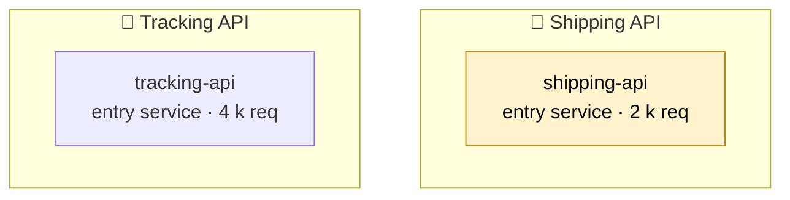
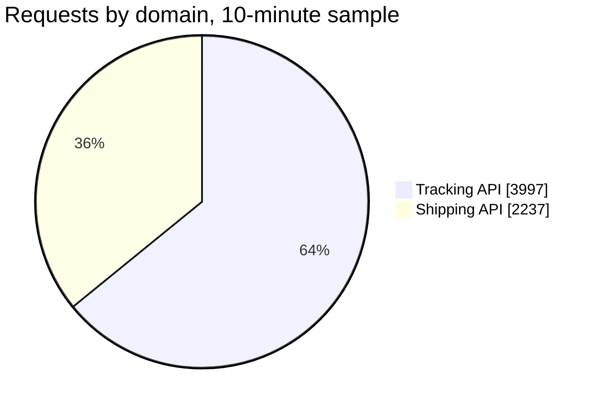

# quickship — Observability Review, November 2026

**What quickship's Tracking API and Shipping API systems did in the 10-minute sample, what it means for users, and what to do next.**

19 Nov 2026

> 📖 **How to read this notebook.** Two findings, each with the evidence, the impact and the actions. Graphs marked *➕ live graph* can be added in a minute with `/timeseries` so the page stays current. Numbers come from a trace sample of 10 minutes (19 Nov 14:00–14:09 UTC). Use **⋮ → Download as PDF** to circulate.

---

## 📌 Executive summary

| # | Finding | Who feels it | Severity | Action |
|---|---|---|---|---|
| 1 | **One slow operation in Shipping API** — `POST /v1/labels` takes 5.86 s at p95 on 397 calls in the 10-minute sample | Users | 🟠 | Tune the slow queries and downstream calls |
| 2 | **One in twelve `POST /v1/labels` calls fails** on `shipping-api` (32 of 397 in the 10-minute sample) | Users | 🟠 | Root-cause the `POST /v1/labels` failures; alert on regressions |
|  | 🧩 Tracking API — healthy: 3,698 business requests in the 10-minute sample, 0.081 % failed, p95 222 ms | Users | ✅ | Keep watching |

---

## 🗺️ What Datadog sees today

Two traced services, 5 endpoints and 6,234 requests in the 10-minute sample, across two domains. The exports do not say which service called which, so the map shows the services only.

| Domain | Services | Requests (10-minute sample) | Failed (business) | p95 |
|---|---|---|---|---|
| 🧩 Tracking API | `tracking-api` | 3,997 (3,698 business) | 0.081 % (0.075 % counting health checks and other noise) | 222 ms |
| 🧩 Shipping API | `shipping-api` | 2,237 (1,937 business) | 2.17 % (1.88 % counting health checks and other noise) | **2.98 s** |

> 🎨 **A rule used throughout:** a request is *failed* when it returns a 5xx or records an application error; 4xx responses are not failures. All counts come from a span sample of 10 minutes and are never scaled up to a day or a week.

---

## 🟠 Finding 1 — One slow operation in Shipping API: `POST /v1/labels` takes 5.86 s at p95

Most of what `shipping-api` serves is quick, but one frequent operation is slow in the 10-minute sample:

| Operation | Calls | p95 |
|---|---|---|
| `POST /v1/labels` | 397 | 5.86 s |

- `POST /v1/labels` is the costliest: 397 calls at 5.86 s p95 — each call keeps someone waiting.

**Actions**
1. Profile `POST /v1/labels` on `shipping-api` (query plan, downstream calls) and set a p95 target.

> ➕ **live graph** — `/timeseries` · `p95:trace.OPERATION{service:shipping-api}` (add a marker at the threshold; replace OPERATION with the span operation name: Metrics Explorer → type trace. → filter service:shipping-api); `/toplist` · `p95:trace.OPERATION{service:shipping-api} by {resource_name}` (slowest features)

---

## 🟠 Finding 2 — One in twelve `POST /v1/labels` calls fails on `shipping-api`

`shipping-api` handled 1,937 business requests in the 10-minute sample and failed 42 of 1,937 (2.17 %). The failures concentrate on one operation:

| Operation | Calls | Failed | Failure rate | p95 |
|---|---|---|---|---|
| `POST /v1/labels` | 397 | **32** | **8.06 %** | 5.86 s |

- **`POST /v1/labels` fails 32 of 397 (8.06 %)** in the 10-minute sample. Each failure is a user or an operator who has to retry, or work that is not done.

**Actions**
1. Pull one day of `POST /v1/labels` failures from the application log and classify them (validation, data, timeout, dependency).
2. Alert on the `trace.*.errors` metric for `POST /v1/labels` once a week of trace data is available, with the threshold at twice the observed hourly average.

> ➕ **live graph** — `/timeseries` · `sum:trace.OPERATION.hits{service:shipping-api,resource_name:post_/v1/labels}.as_count()` (requests); `/timeseries` · `sum:trace.OPERATION.errors{service:shipping-api,resource_name:post_/v1/labels}.as_count()` (failures, as red bars; replace OPERATION with the span operation name: Metrics Explorer → type trace. → filter service:shipping-api)

---

## ✅ Recommendations, in order

| When | What | Why |
|---|---|---|
| **Now** | Pull one day of `POST /v1/labels` failures from the application log and classify them (validation, data, timeout, dependency) | Finding 2 — One in twelve `POST /v1/labels` calls fails on `shipping-api` |
| **Now** | Alert on the `trace.*.errors` metric for `POST /v1/labels` once a week of trace data is available, with the threshold at twice the observed hourly average | Finding 2 — One in twelve `POST /v1/labels` calls fails on `shipping-api` |
| **Next** | Profile `POST /v1/labels` on `shipping-api` (query plan, downstream calls) and set a p95 target | Finding 1 — One slow operation in Shipping API: `POST /v1/labels` takes 5.86 s at… |

---

## 📎 Appendix

**Data analysed.**
- Trace sample `spans-2026-11-19.csv`: 6,234 spans, 2026-11-19 14:00:00–14:09:59 UTC (10 minutes).

**Definitions.** *Failed* = a request that returns a 5xx or records an application error; 4xx responses are not failures. *p95* = 95 % of requests finish within this time. A service's p95 is the request-weighted p95 of its business entry spans in the sample. Counts from the span sample are quoted as sample counts and never scaled. Entry requests in the span sample were identified by the rule *method or a VERB /path resource present, and the service is neither an integration library nor a host name*.

**Noise excluded from business totals** (every exclusion, with the rule that made it):

| Class | Rule | Source | Endpoints | Requests removed | Failures removed |
|---|---|---|---|---|---|
| health | built-in health pattern | builtin | 2 | 599 | 0 |

**All traced services** (requests in the 10-minute sample; failure % on business operations; p95 from the span sample):

| Service | Requests | Failure % (business) | p95 | Monitors | Stack / operation |
|---|---|---|---|---|---|
| `tracking-api` | 3,997 | 0.081 % | 222 ms | — | — |
| `shipping-api` | 2,237 | 2.17 % | 2.98 s | — | — |

**Not covered this month.** *failing dependencies* was not checked (needs caller data: add Parent ID or peer.service to the spans export, or export the inferred services list). *work inside a request* was not checked (needs child spans with their parents: add Trace ID, Span ID and Parent ID to the spans export). *public egress and telemetry* was not checked (needs caller data: add Parent ID or peer.service to the spans export, or export the inferred services list). *regressions since last month* was not checked (needs last month's review: no earlier month's review was found for this organisation; next month's review compares itself with this one).

To see more next month: export APM › Software Catalog › Endpoints (7 days) to get complete weekly volumes and per-endpoint failure counts; export APM › Software Catalog › Services to get monitor and SLO coverage, env tags and service-level p95; export the Services list with inferred services shown to get the hosts your services call (dependency health, non-prod and public egress); add Trace ID, Span ID and Parent ID columns to the spans export to get the request-anatomy diagram and caller attribution.

**Caveats.**
- without Parent ID, Type or Operation Name in the spans export, outbound HTTP calls that carry the calling service's name cannot be told apart from incoming requests; request totals may include some outbound calls
- services were grouped by name, not by business domain

**Method.** Every figure above was computed from the exports by the review generator (ddreview 1.0.0) and recorded in `facts.json`; keep that file to compare next month. Mermaid diagrams are drawn from the same tables. The generator writes a first draft in one command; read every finding before sharing.
